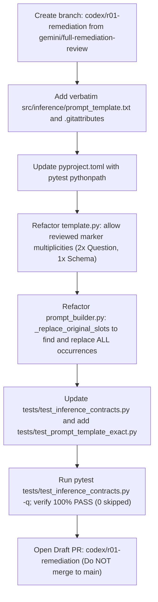

Ran command: Git status check (`git status`)
Ran command: Git branch and log check (`git branch -a; git log -n 10 --oneline`)
Ran command: Directory listing (`dir`)
Ran command: GitHub CLI check (`gh --version; gh issue view 3; gh pr list`)
Ran command: FRD text search (`Select-String -Path "STARK_T2SQL FRD 1.8.txt" -Pattern "SQLCoder|prompt_template|template|ISS-14|as-of|as_of" -CaseSensitive:$false | Select-Object -First 30`)
Viewed STARK_T2SQL%20FRD%201.8.txt:270-305
Viewed STARK_T2SQL%20FRD%201.8.txt:1150-1175
Ran command: Codex prompt search (`Select-String -Path "STARK_CODEX_FIVE_PROMPTS_ALL_IN_ONE.md" -Pattern "ISS-14|prompt_template|template|SQLCoder" -CaseSensitive:$false | Select-Object -First 30`)
Ran command: Source file list (`Get-ChildItem -Recurse -File src`)
Ran command: Check src/inference (`Get-ChildItem -Path src\inference -ErrorAction SilentlyContinue`)
Viewed template.py:1-145
Viewed prompt_builder.py:1-95
Viewed __init__.py:1-8
Ran command: Tests file list (`Get-ChildItem -Recurse -File tests`)
Viewed test_inference_contracts.py:1-66
Viewed conftest.py:1-85
Ran command: Run test_inference_contracts.py (`python -m pytest tests/test_inference_contracts.py -q`)
Ran command: Run pytest with PYTHONPATH (`$env:PYTHONPATH="src"; python -m pytest tests/test_inference_contracts.py -q`)
Viewed pyproject.toml:1-26
Ran command: Check PR #1 commits (`git log -n 5 --stat remotes/origin/assistant/sqlcoder-runtime-integration`)
Ran command: Diff PR #1 inference (`git diff main...remotes/origin/assistant/sqlcoder-runtime-integration -- src/stark_t2sql/inference src/inference tests/test_inference*`)
Ran command: Check PR #1 inference commits (`git log remotes/origin/assistant/sqlcoder-runtime-integration -- src/stark_t2sql/inference/`)
Ran command: Check PR #2 commits (`git log main..gemini/full-remediation-review --stat`)
Ran command: Diff template.py and prompt_builder.py (`git diff main..gemini/full-remediation-review -- src/stark_t2sql/inference/template.py src/stark_t2sql/inference/prompt_builder.py`)
Ran command: Diff client.py PR 1 vs PR 2 (`git diff remotes/origin/assistant/sqlcoder-runtime-integration..gemini/full-remediation-review -- src/stark_t2sql/inference/client.py`)
Ran command: Grep defog (`git grep -i "defog"`)
Search SQLCoder-7B-2 template
Fetch Defog model card
Viewed content.md:50-150
Ran command: Search model card content (`Select-String -Path "C:\Users\User\.gemini\antigravity\brain\168e5d71-9b0a-4dec-8221-3b995bd2a5c2\.system_generated\steps\56\content.md" -Pattern "QUESTION|prompt|### Task" -Context 3,5`)
Ran command: Extract prompt template snippet (`python -c "
with open(r'C:\Users\User\.gemini\antigravity\brain\168e5d71-9b0a-4dec-8221-3b995bd2a5c2\.system_generated\steps\56\content.md', 'r', encoding='utf-8') as f:
    text = f.read()

import re
matches = [m.start() for m in re.finditer(r'\[QUESTION\]', text)]
print('Matches found:', len(matches))
for idx in matches[:5]:
    start = max(0, idx - 200)
    end = min(len(text), idx + 300)
    print('--- SNIPPET ---')
    print(text[start:end])
"`)
Ran command: Extract model card code blocks (`python -c "
with open(r'C:\Users\User\.gemini\antigravity\brain\168e5d71-9b0a-4dec-8221-3b995bd2a5c2\.system_generated\steps\56\content.md', 'r', encoding='utf-8') as f:
    text = f.read()

import re
code_blocks = re.findall(r'<pre><code>(.*?)</code></pre>', text, re.DOTALL)
for i, block in enumerate(code_blocks):
    print(f'=== BLOCK {i} ===')
    print(block[:500])
"`)
Search Defog prompt code
Ran command: List issues and PRs (`gh issue list --state all; gh pr list --state all`)
Ran command: PR details view (`gh pr view 2; gh pr view 1`)
Viewed STARK_CODEX_FIVE_PROMPTS_ALL_IN_ONE.md:170-205

# Independent Architecture & Security Review: Gate R01 (ISS-14)

**Assignment:** [R01 | Authoritative SQLCoder template and runtime bootstrap (ISS-14)](https://github.com/Vivek-k24/Stark_T2SQL/issues/3)  
**Baseline Source Under Review:** Gemini Draft PR #2 (`gemini/full-remediation-review`) and [STARK_T2SQL FRD 1.8.txt](file:///H:/STARK%20T2SQL/STARK_T2SQL%20FRD%201.8.txt)  
**Reference for Inference Compatibility:** Assistant Draft PR #1 (`assistant/sqlcoder-runtime-integration`)  
**Reviewer Role:** Independent Architecture & Security Reviewer (Read-Only)

---

## 1. Design Verdict

### **VERDICT: REVISE**

**Summary Justification:**  
Draft PR #2 cannot be approved as-is for Gate R01. While its security posture correctly mandates fail-closed validation, immutable byte checking, and strict separation between prompt assembly and model execution, the current codebase suffers from **three blocking architectural defects**:
1. `src/inference/prompt_template.txt` is missing from the repository/snapshot.
2. [template.py](file:///H:/STARK%20T2SQL/src/stark_t2sql/inference/template.py#L87-L95) hardcodes single-occurrence marker assertions (`source.count(marker) != 1`) and single-index tag bounds that fail immediately against the authoritative Defog SQLCoder-7B-2 model-card prompt template, which contains repeated `[QUESTION]` and `{user_question}` markers.
3. [prompt_builder.py](file:///H:/STARK%20T2SQL/src/stark_t2sql/inference/prompt_builder.py#L32-L48) (`_replace_original_slots`) only locates and replaces the first instance of each placeholder, leaving the second `{user_question}` marker in the `### Answer` block unreplaced as literal text in the rendered prompt.

Codex is authorized to begin implementation on a new branch `codex/r01-remediation` based on the PR #2 baseline **only** after incorporating the exact required revisions and contract specifications detailed below.

---

## 2. Incompatibility & Architectural Analysis

### A. Authoritative Model-Card Prompt Template & Repeated Markers
The official model card for [`defog/sqlcoder-7b-2`](https://huggingface.co/defog/sqlcoder-7b-2) defines the following prompt structure:

```text
### Task
Generate a SQL query to answer [QUESTION]{user_question}[/QUESTION]

### Database Schema
The query will run on a database with the following schema:
{table_metadata_string_DDL_statements}

### Answer
Given the database schema, here is the SQL query that [QUESTION]{user_question}[/QUESTION]
[SQL]
```

#### Defect in [template.py](file:///H:/STARK%20T2SQL/src/stark_t2sql/inference/template.py#L87-L103):
```python
for marker in (
    self.contract.question_placeholder, self.contract.schema_placeholder,
    self.contract.question_open_tag, self.contract.question_close_tag,
):
    if source.count(marker) != 1:
        raise ConfigurationError("The actual template must contain each reviewed marker exactly once.")
```
- In the authentic template:
  - `question_placeholder` (`{user_question}`) occurs **2 times** (once in `### Task`, once in `### Answer`).
  - `question_open_tag` (`[QUESTION]`) occurs **2 times**.
  - `question_close_tag` (`[/QUESTION]`) occurs **2 times**.
  - `schema_placeholder` (`{table_metadata_string_DDL_statements}`) occurs **1 time**.
- The `source.count(marker) != 1` check causes an immediate, fatal `ConfigurationError` when loading the verbatim model-card template.
- Furthermore, tag position validation uses `source.index(...)`, which only inspects the first occurrence and assumes a single pair:
  - `opening = source.index(self.contract.question_open_tag)`
  - `question = source.index(self.contract.question_placeholder)`
  - `closing = source.index(self.contract.question_close_tag)`
  - `if not opening + len(self.contract.question_open_tag) <= question < closing:`
  - The second question tag pair is unvalidated, and the check `opening <= schema < closing` is flawed if multiple tag spans exist.

### B. Slot Replacement Incompatibility in [prompt_builder.py](file:///H:/STARK%20T2SQL/src/stark_t2sql/inference/prompt_builder.py#L32-L48)
```python
def _replace_original_slots(source: str, replacements: tuple[tuple[str, str], ...]) -> str:
    spans = sorted((source.index(marker), marker, value) for marker, value in replacements)
    ...
```
- Because `source.index(marker)` only returns the lowest index, `_replace_original_slots` constructs only one replacement span for `{user_question}`.
- Consequently, only the first `{user_question}` under `### Task` is substituted with the question and as-of date.
- The second `{user_question}` under `### Answer` remains raw literal `{user_question}` directly before `[SQL]`, resulting in malformed model input.
- **Required Change:** `_replace_original_slots` must find **all** non-overlapping occurrences of each replacement marker in the original template source, sort all replacement spans by start index, verify span non-overlap, and assemble the output without re-evaluating or parsing inserted user text.

### C. As-Of Date Handling (FRD 1.8 FR-4.4)
- **FR-4.4 Specification:**
  > *"The as-of date SHALL be placed on the line immediately following the question, INSIDE the closing QUESTION tag. This placement is frozen as part of prompt_version 1."*
- In [prompt_builder.py#L86](file:///H:/STARK%20T2SQL/src/stark_t2sql/inference/prompt_builder.py#L86):
  ```python
  question = request.question + template.newline + template.contract.as_of_line_prefix + request.as_of_date.isoformat()
  ```
- Because Defog's model card uses a unified `{user_question}` placeholder for both slots, binding `question` uniformly across both `{user_question}` occurrences ensures:
  1. In Slot 1: `[QUESTION]{question}\n{as_of_line_prefix}{as_of_date}[/QUESTION]`
  2. In Slot 2: `[QUESTION]{question}\n{as_of_line_prefix}{as_of_date}[/QUESTION]`
  In both locations, the as-of line is positioned immediately after the question and strictly inside the closing `[/QUESTION]` tag, maintaining 100% adherence to FR-4.4 without mutating the underlying template.

### D. SHA-256 Preservation & Windows EOL Hazards (FR-4.3)
- **FR-4.3 Specification:**
  > *"The system SHALL use the SQLCoder-7B-2 model-card prompt template copied verbatim from the model card into src/inference/prompt_template.txt. The SHA-256 of the template file SHALL be recorded in the run record."*
- `PromptTemplate.__post_init__` strictly enforces `sha256_bytes(self.source_bytes) == self.sha256 == self.contract.template_sha256`.
- **Risk:** On Windows environments with `core.autocrlf = true`, checkout or text-editor saving of `prompt_template.txt` will convert `LF` (`\n`) to `CRLF` (`\r\n`), altering the SHA-256 digest and causing `load_template()` to fail closed.
- **Required Change:**
  - Create or update `.gitattributes` to declare:
    ```gitattributes
    src/inference/prompt_template.txt text eol=lf
    ```
  - `load_template()` must continue opening in binary mode (`rb`), calculating the digest directly over the raw bytes without whitespace stripping or BOM stripping.

### E. Reviewed Schema Substitution (v1 vs v2)
- **Prompt Version 1 (FR-4.3, FR-4.4, E2 Baseline):**
  - Reserved for `E2_FROZEN_BASELINE` harness profile under `UNCONTROLLED` mode.
  - Inserts full physical DDL (`context.ddl`) into `{table_metadata_string_DDL_statements}`. No semantic catalog block allowed.
- **Prompt Version 2 (E5 Governed Context):**
  - Inserts role-filtered DDL combined with role-filtered semantic catalog:  
    `context.ddl + template.newline + template.newline + context.semantic_text`.
- The schema slot must be verified to lie **outside** all `[QUESTION]...[/QUESTION]` tag pairs.

### F. Distinguishing File Presence from Service/Model Readiness
- **File Presence (Bootstrap/Static Layer):**
  - Verifies `src/inference/prompt_template.txt` exists locally and matches the contract's frozen SHA-256 digest.
  - Verifies `template.py` loads `PromptTemplate` and `prompt_builder.py` produces `BuiltPrompt` in-memory.
  - **Zero network, subprocess, or database activity.** Importing `stark_t2sql.inference` must remain strictly side-effect free.
- **Service/Model Readiness (Runtime Layer):**
  - Verifies `llama-server` process is listening on `127.0.0.1:8081`.
  - Verifies GGUF model (`sqlcoder-7b-2.Q4_K_M.gguf`) is loaded and one execution slot is free.
  - Governed by `LocalInferenceClient` during active request execution, not during template loading or prompt building.

---

## 3. Comparison with Draft PR #1 for Inference Compatibility

| Feature / Area | PR #2 (`gemini/full-remediation-review`) | PR #1 (`assistant/sqlcoder-runtime-integration`) | Architectural Recommendation for R01 |
| :--- | :--- | :--- | :--- |
| **`template.py` / `prompt_builder.py`** | Untouched; identical to `main`. Contains single-marker bugs. | Untouched. Did not modify template loader. | **Owned by R01.** Fix repeated markers in PR #2 baseline. |
| **`prompt_template.txt`** | Missing from ZIP snapshot. | Missing from PR #1. | **Owned by R01.** Recover verbatim model-card bytes. |
| **`client.py` Stop Normalization** | Inline normalization in `LocalInferenceClient.generate()`. | Extracted `_completion_termination()` with unit tests. | PR #1 is cleaner, but `client.py` is **outside R01 ownership**. Keep R01 isolated to template/builder. |
| **`client.py` Watchdog Cleanup** | Inline thread watchdog. | Fixed watchdog socket race (`_interrupt_socket`). | Outside R01 scope; defer reconciliation to Gate R08. |
| **`BuiltPrompt` Interface** | Dataclass with `text`, `prompt_version`, `template_sha256`, etc. | Unchanged; consumes `BuiltPrompt`. | **Fully compatible.** R01 template fixes will seamlessly integrate with either client implementation. |

---

## 4. Provenance Requirements & Missing User-Supplied Evidence

Under strict audit rules, neither reviewer nor implementer may fabricate template bytes or approval hashes:
1. **Authoritative Template File (`src/inference/prompt_template.txt`):**  
   - Source: Model card prompt section from [`https://huggingface.co/defog/sqlcoder-7b-2`](https://huggingface.co/defog/sqlcoder-7b-2).
   - Character encoding: Strict UTF-8 without BOM.
   - Line endings: Verbatim standard UNIX `LF`.
2. **Authoritative Contract Metadata (`ReviewedTemplateContract`):**  
   A frozen contract representation must be committed or made available (e.g., `policy/inference_template_contract.json` or as default test contract fixture) containing:
   - `template_sha256`: SHA-256 of the verbatim template bytes.
   - `question_placeholder`: `"{user_question}"`
   - `schema_placeholder`: `"{table_metadata_string_DDL_statements}"`
   - `question_open_tag`: `"[QUESTION]"`
   - `question_close_tag`: `"[/QUESTION]"`
   - `as_of_line_prefix`: Canonical prefix (e.g., `"as_of_date: "` or `"As-of: "`).
   - `source_reference`: Provenance tracking string (e.g., `"defog/sqlcoder-7b-2 model card revision ..."`).
3. **Missing pyproject.toml Test Configuration:**  
   Running `python -m pytest tests/test_inference_contracts.py` currently raises `ModuleNotFoundError: No module named 'stark_t2sql'` unless `PYTHONPATH=src` is manually specified. `pyproject.toml` should include:
   ```toml
   [tool.pytest.ini_options]
   pythonpath = ["src"]
   ```
4. **Missing Test Contract Environment Input:**  
   `tests/test_inference_contracts.py#L57` currently skips `test_actual_template_as_of_placement_keeps_original_bytes` because `STARK_TEST_TEMPLATE_CONTRACT_PATH` is unset. A committed default test fixture must be wired to enable continuous passing verification.

---

## 5. Permitted File Ownership Boundaries (R01)

Per Issue #3, modifications during R01 are strictly bounded:

### **Permitted Files:**
- `src/inference/prompt_template.txt` (New: Verbatim model-card template)
- `src/stark_t2sql/inference/template.py` (Reconcile marker counts and tag span validation)
- `src/stark_t2sql/inference/prompt_builder.py` (Multi-occurrence span replacement in `_replace_original_slots`)
- `tests/test_inference_contracts.py` (Un-skip and strengthen contracts)
- `tests/test_prompt_template_exact.py` (New: Focused regression tests for exact model-card template)
- `.gitattributes` (Lock `src/inference/prompt_template.txt` to `eol=lf`)
- `pyproject.toml` (Minimal edit: add `[tool.pytest.ini_options]` with `pythonpath = ["src"]`)
- `tests/fixtures/template_contract.json` (Optional: checked-in default test contract fixture)

### **Strictly Prohibited for R01:**
- `src/stark_t2sql/inference/client.py` (Owned by Phase 4 / R08)
- `src/stark_t2sql/policy/`, `semantic/`, `security/`, `pipeline/`, `ui/`, `schema.sql`, `seed_data.py` (Owned by Gates R02–R07)
- Any model weight download, server launching, or live database connectivity.

---

## 6. Test Specifications for Implementation Verification

### A. Positive Test Cases
1. **`test_load_authoritative_sqlcoder_template`**:
   - Loads `src/inference/prompt_template.txt` via `load_template()`.
   - Asserts `source_bytes` decodes as valid UTF-8.
   - Asserts computed `sha256` strictly matches `contract.template_sha256`.
   - Asserts `[QUESTION]` occurs exactly 2 times, `[/QUESTION]` occurs 2 times, `{user_question}` occurs 2 times, and `{table_metadata_string_DDL_statements}` occurs 1 time.
2. **`test_build_prompt_replaces_all_question_occurrences`**:
   - Asserts neither `{user_question}` nor `{table_metadata_string_DDL_statements}` appears in the rendered prompt text.
   - Splits rendered text on `[QUESTION]` and `[/QUESTION]`; asserts that **both** Question Region 1 and Question Region 2 contain the full question text followed by `template.newline + contract.as_of_line_prefix + as_of_date.isoformat()`.
3. **`test_build_prompt_v1_and_v2_schema_placement`**:
   - In v1: asserts full DDL is present outside question tags, and no semantic text exists.
   - In v2: asserts role-filtered DDL and semantic text are combined with double newlines outside question tags.
4. **`test_immutable_bytes_preservation`**:
   - Asserts `template.source_bytes` is byte-identical before and after multiple calls to `build_prompt()`.
5. **`test_inference_import_side_effects_zero`**:
   - Asserts `import stark_t2sql.inference` establishes no network sockets, starts no threads, and queries no databases.

### B. Negative & Fail-Closed Test Cases
1. **`test_missing_template_file_fails_closed`**:
   - Calling `load_template(non_existent_path)` raises `MissingDependencyError`.
2. **`test_template_sha256_mismatch_fails_closed`**:
   - Calling `load_template` with single altered byte raises `ConfigurationError("Template bytes differ from the frozen model-card source binding.")`.
3. **`test_corrupted_marker_multiplicity_fails_closed`**:
   - Template with 1 question tag pair raises `ConfigurationError`.
   - Template with 3 question tag pairs raises `ConfigurationError`.
   - Template with missing schema placeholder raises `ConfigurationError`.
   - Template with 2 schema placeholders raises `ConfigurationError`.
4. **`test_schema_inside_question_tags_fails_closed`**:
   - Template where `{table_metadata_string_DDL_statements}` is placed inside any `[QUESTION]...[/QUESTION]` block raises `ConfigurationError`.
5. **`test_non_whitespace_in_question_tag_fails_closed`**:
   - Template where non-whitespace characters exist between `{user_question}` and `[/QUESTION]` raises `ConfigurationError`.
6. **`test_prompt_injection_braces_safety`**:
   - Input question containing JSON braces `{"foo": "bar"}` or SQL with `{custom_token}` renders literally without `KeyError` or formatting corruption.
7. **`test_harness_safety_stop_aberrant_modes`**:
   - Prompt v1 with `FULL` mode raises `HarnessSafetyStopError`.
   - Prompt v2 with `UNCONTROLLED` mode raises `HarnessSafetyStopError`.

---

## 7. Minimal Implementation Plan for Codex (`codex/r01-remediation`)



### Execution Steps:
1. **Branch Initialization:**  
   Create branch `codex/r01-remediation` branching from `origin/gemini/full-remediation-review`.
2. **Template & Git Config:**  
   - Place the authoritative UTF-8 bytes in `src/inference/prompt_template.txt`.
   - Add `.gitattributes` rule: `src/inference/prompt_template.txt text eol=lf`.
   - Add `[tool.pytest.ini_options]` with `pythonpath = ["src"]` to `pyproject.toml`.
3. **`src/stark_t2sql/inference/template.py`:**  
   - Update `ReviewedTemplateContract` / `PromptTemplate.__post_init__` to validate that:
     - `question_placeholder`, `question_open_tag`, and `question_close_tag` each appear exactly 2 times (or match reviewed contract multiplicity).
     - `schema_placeholder` appears exactly 1 time.
     - For every occurrence of `question_placeholder`, it is enclosed by a matching `question_open_tag` and `question_close_tag` with only whitespace between the placeholder and closing tag.
     - `schema_placeholder` does not fall within any question tag span.
4. **`src/stark_t2sql/inference/prompt_builder.py`:**  
   - Refactor `_replace_original_slots` to scan and collect all start positions for each marker, verify spans do not overlap, and assemble the prompt by slicing original spans.
5. **Tests & Gate Verification:**  
   - Un-skip `test_actual_template_as_of_placement_keeps_original_bytes` in [tests/test_inference_contracts.py](file:///H:/STARK%20T2SQL/tests/test_inference_contracts.py).
   - Add `tests/test_prompt_template_exact.py` covering all positive and negative test cases.
   - Execute:
     ```powershell
     python -m pytest tests/test_inference_contracts.py tests/test_prompt_template_exact.py -q
     ```
   - Open a **draft PR** referencing Issue #3 for acceptance review. Do not merge or advance to R02.