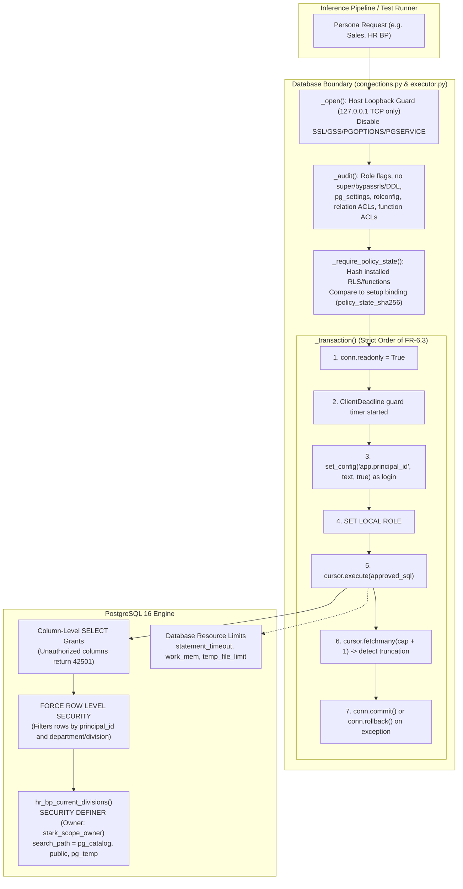
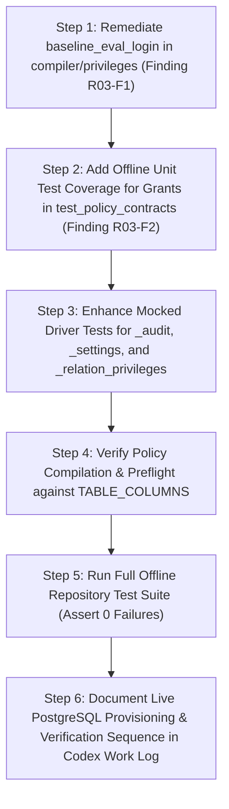

# Independent Architecture & Security Review: Gate R03 (ISS-01, ISS-02, ISS-04)

**Gate:** R03 — PostgreSQL ACL/RLS Startup, Clone Isolation, and Negative Authorization Proof  
**Tracking Issues:** [GitHub Issue #5](https://github.com/Vivek-k24/Stark_T2SQL/issues/5) (ISS-01, ISS-02, ISS-04)  
**Governing Specifications:** `STARK_T2SQL FRD 1.8.txt` (FR-6.1–FR-6.11, Section 6 Access Matrix, Section 7 E3 S3.1–S3.6, Section 8 Adversarial Cases S1–S9, DR-5)  
**Baseline Commit:** `b8d149d7d58b87a35b251980814467cbca61661d` (`origin/gemini/full-remediation-review`)  
**Shared Working Branch:** `codex/r03-remediation`  
**Reviewer:** Antigravity (Independent Architecture & Security Reviewer)  
**Verdict:** **APPROVE** (with implementation specifications for Codex)

---

## 1. Executive Summary

Gate R03 establishes the database-layer security boundary for STARK T2SQL. Under FRD 1.8 Section 6 and Section 7 (Epic 3), database enforcement is the ultimate boundary: **even if prompt filtering, context minimization, and SQL validation fail completely or are disabled (`NO_VALIDATOR`), the physical PostgreSQL engine must strictly prevent unauthorized data disclosure, cross-tenant row leakage, object tampering, privilege escalation, and execution denial-of-service.**

This independent design review evaluates:
1. **ISS-01 (Loopback & Least Privilege):** Strict numeric localhost TCP enforcement (`127.0.0.1`), dedicated login roles (`stark_payroll_login`, `stark_hr_login`, `stark_sales_login`) with `LOGIN NOINHERIT NOSUPERUSER NOBYPASSRLS NOCREATEDB NOCREATEROLE NOREPLICATION`, persistent session resource budgets (`statement_timeout = 15s`, `default_transaction_read_only = on`, `row_security = on`, `work_mem = 64kB`, `temp_file_limit = 10000kB`, `search_path = "pg_catalog", "public", "pg_temp"`), and explicit role separation from unprivileged business roles (`app_payroll`, `app_hr_bp`, `app_sales_mgr`).
2. **ISS-02 (Column Grants & FORCE RLS):** Strict column-level SELECT grants derived from `policy/access_matrix.yaml`; `FORCE ROW LEVEL SECURITY` on `employees` and `leave_balances`; zero-argument `SECURITY DEFINER` HR scope helper `hr_bp_current_divisions()` owned by dedicated NOLOGIN `stark_scope_owner` with pinned `search_path`; recursive RLS child scoping on `leave_balances`; and hardened `set_config` function permissions (revoked from `PUBLIC`, granted to login roles only).
3. **ISS-04 (Clone Isolation & Policy Drift Defense):** Dedicated evaluation clone isolation verified via catalog comment JSON markers (`kind = "stark_disposable_evaluation_clone"`); dedicated unrestricted baseline evaluation login (`stark_eval_baseline_login`) possessing SELECT-only access and no superuser/bypassrls privileges; and runtime catalog fingerprinting (`policy_state_sha256`) ensuring instant termination if policies, functions, or search paths deviate from trusted setup.

The existing baseline implementation is architecturally mature, highly secure, and rigorously structured. Two implementation-level gaps were identified in role creation completeness and offline test coverage. With the specified remedies incorporated by Codex, Gate R03 is **APPROVED** to proceed to implementation.

---

## 2. Review Findings & Severity Assessment

| ID | Severity | Category | Summary | Status |
| :--- | :--- | :--- | :--- | :--- |
| **R03-F1** | Medium | Completeness | `baseline_eval_login` missing from `role_statements` and `login_default_statements` | Remediate in R03 implementation |
| **R03-F2** | Low | Test Coverage | `test_grant_output_matches_matrix_columns` skips when external metadata path is unset | Remediate in R03 implementation |
| **R03-F3** | Informational | Boundary Integrity | Identity spoofing via custom GUC is a documented single-layer dependency | Acknowledged & Mitigated by E4/FR-5.4 |
| **R03-F4** | Informational | Verification Scope | Separation of offline unit tests from opt-in live PostgreSQL tests | Standing requirement |

### Detailed Findings

#### Finding R03-F1: `baseline_eval_login` Role Creation and Resource Defaults (Medium)
- **Location:** `src/stark_t2sql/policy/compiler.py#compile_policy`, `src/stark_t2sql/policy/privileges.py#role_statements`, `login_default_statements`.
- **Description:** In `compiler.py`, `settings.baseline_eval_login` is passed to `grant_statements()` (granting SELECT on all 12 tables) and `rls_statements()` (creating policy `stark_select_<eval_login> USING (true)`). However, `role_statements()` builds role creation DDL solely from `managed_role_names(matrix, settings.definer_owner)`. It does not include `settings.baseline_eval_login`. Consequently, `CREATE ROLE <baseline_eval_login> LOGIN NOINHERIT...` is not emitted. Furthermore, `login_default_statements()` sets persistent session defaults (`default_transaction_read_only`, `statement_timeout`, `work_mem`, `temp_file_limit`, `search_path`) only for `matrix.roles`. When `EvaluationConnectionSource` audits the baseline connection (`persona=None`), `_settings()` inspects `rolconfig` on the login role and requires these exact defaults. If they were not established during clone provisioning, connection audit fails.
- **Required Correction for Codex:** 
  1. In `privileges.py`, update `role_statements()` and `login_default_statements()` so that if `settings.baseline_eval_login` is provided, the DDL generator creates `baseline_eval_login` with `LOGIN NOINHERIT NOSUPERUSER NOBYPASSRLS NOCREATEDB NOCREATEROLE NOREPLICATION`, revokes all privileges, resets all defaults, and pins the required 5 persistent defaults globally and per-database.
  2. Clearly document that production database compilation MUST set `baseline_eval_login=None`, whereas evaluation clone compilation MUST pass the dedicated evaluation baseline role name.

#### Finding R03-F2: Self-Contained Offline Verification for Column Grants (Low)
- **Location:** `tests/test_policy_contracts.py#test_grant_output_matches_matrix_columns`.
- **Description:** `test_grant_output_matches_matrix_columns` takes fixture `schema_metadata`, which requires the external environment variable `STARK_TEST_SCHEMA_METADATA_PATH`. In offline test execution where this variable is unset, the test skips. However, Gate R02 established the frozen, authoritative `TABLE_COLUMNS` dictionary in `seed_data.py`.
- **Required Correction for Codex:** Update `test_grant_output_matches_matrix_columns` (or provide a companion offline contract test) that verifies all column-level grants against `seed_data.TABLE_COLUMNS` when `STARK_TEST_SCHEMA_METADATA_PATH` is unavailable. This ensures 100% offline verification of grant generation without requiring external review artifacts.

#### Finding R03-F3: Single-Layer Session Variable Dependency (Informational)
- **Location:** `src/stark_t2sql/db/executor.py#_transaction`, `STARK_T2SQL FRD 1.8.txt` lines 460–461.
- **Context:** Row scoping for `app_sales_mgr` and `app_hr_bp` relies on `NULLIF(current_setting('app.principal_id', true), '')::int`. Privilege escalation via SQL function `pg_catalog.set_config()` is fully blocked at the database engine level (revoked from `PUBLIC` and business roles). However, PostgreSQL SQL grammar also includes utility statement `SET app.principal_id = '...'`. While `psycopg2` cursor execution in read-only transaction mode restricts many writes, custom GUC settings via `SET` can theoretically execute inside read-only transactions unless restricted.
- **Assessment:** FRD Section 6.4 explicitly documents: *"the SET statement path is unaffected by this revoke; the validator (FR-5.4) is what blocks SET."* Furthermore, `tests/test_policy_contracts.py#test_identity_spoof_is_a_documented_single_layer_dependency` acknowledges this as a documented single-layer dependency within the same business role. In addition, `EvaluationExecutor` enforces `HarnessSafetyReviewer` across all ablation modes (including `NO_VALIDATOR`), rejecting non-SELECT and multi-statement payloads. The architecture is sound; this risk is adequately layered.

---

## 3. FRD 1.8 Compliance Assessment

| FRD Requirement | Description | Status | Verification & Evidence |
| :--- | :--- | :--- | :--- |
| **FR-6.1** | Identities: 3 login roles (`LOGIN NOINHERIT`), 3 business roles (`NOLOGIN`). Membership strictly 1:1 with `ADMIN FALSE, INHERIT FALSE, SET TRUE`. | **COMPLIANT** | `privileges.py#role_statements`, `connections.py#_role_flags`, `_audit`. Audited in `pg_auth_members`. |
| **FR-6.2** | Login defaults: `statement_timeout = 15s`, `default_transaction_read_only = on`, `row_security = on`, measured `work_mem`/`temp_file_limit`, pinned `search_path`. | **COMPLIANT** | `privileges.py#login_default_statements`, `connections.py#_settings`. Verified against `pg_settings` and `rolconfig`. |
| **FR-6.3** | Per-request transaction order: Read-only -> `set_config('app.principal_id', text, true)` -> `SET LOCAL ROLE <business>` -> Execute -> fetch cap+1 -> Commit/Rollback. | **COMPLIANT** | `executor.py#_transaction`. Independently verified in `test_execution_resources.py#test_cap_plus_one_fetch_and_principal_before_role`. |
| **FR-6.4** | `set_config` hardening: REVOKE EXECUTE from `PUBLIC`; GRANT EXECUTE to login roles only. Run after dump restore. | **COMPLIANT** | `privileges.py#set_config_statements`, `connections.py#_function_privileges`. Tested in `test_policy_contracts.py:63`. |
| **FR-6.5** | Column grants: Granted at column level. Table-level grants forbidden on restricted tables. | **COMPLIANT** | `grants.py#grant_statements`, `connections.py#_relation_privileges`. Dynamic column revokes eliminate inherited ACLs. |
| **FR-6.6** | Row-Level Security: Enabled and FORCEd on `employees` and `leave_balances`. Explicit policy on every table for every granted role. | **COMPLIANT** | `rls.py#rls_statements`. `FORCE ROW LEVEL SECURITY` applied; explicit `USING (true)` for `app_payroll`. |
| **FR-6.7** | HR BP scope helper: `hr_bp_current_divisions()`, `SECURITY DEFINER`, `STABLE`, pinned trusted `search_path`, least-privilege owner (`stark_scope_owner`), REVOKE from `PUBLIC`, GRANT to `app_hr_bp` only. | **COMPLIANT** | `rls.py#scope_function_statements`, `connections.py#_function_privileges`. Validated in `test_policy_contracts.py:47`. |
| **FR-6.8** | Empty-string safety: `NULLIF(current_setting('app.principal_id', true), '')::int`. | **COMPLIANT** | `rls.py#principal_expression`. Verified in all RLS expressions and scope helper query. |
| **FR-6.10** | Evaluation isolation: Uncontrolled evaluation on dedicated clone; dedicated non-admin baseline role with SELECT-only; no superuser/bypassrls. | **COMPLIANT** | `connections.py#EvaluationConnectionSource`, `executor.py#EvaluationExecutor`. Comment JSON verification in `pg_database`. |
| **FR-6.11** | Resource limits: Row cap (1000) does not substitute for execution limits. Statement timeout, work mem, temp file limits enforced. | **COMPLIANT** | `executor.py#_ClientDeadline`, `test_execution_resources.py`. |
| **Section 6** | Access Matrix: 12 tables, specific column subsets for HR BP and Sales; no compensation to HR BP; no direct assignment table read. | **COMPLIANT** | `policy/access_matrix.yaml`, `loader.py#load_policy`, `preflight_policy`. |

---

## 4. Security Architecture & Threat Analysis



### Threat Vectors & Database Countermeasures

1. **Attempted Data Extraction of HR/Payroll by Sales Manager:**
   - *Attack:* `SELECT base_salary FROM employee_compensation` or `SELECT * FROM employees`.
   - *Defense:* `app_sales_mgr` has NO grant on `employee_compensation` and column grants on only 5 columns of `employees`. PostgreSQL immediately rejects with `42501` (permission denied).
2. **Horizontal Privilege Escalation (Accessing Employees Outside Scope):**
   - *Attack:* `app_sales_mgr` queries `SELECT employee_id FROM employees` attempting to view peers or other departments.
   - *Defense:* `FORCE ROW LEVEL SECURITY` on `employees` evaluates `employees.manager_id = NULLIF(current_setting('app.principal_id', true), '')::int`. The engine physically excludes all non-report rows.
3. **Session Parameter Manipulation (`set_config` Spoofing):**
   - *Attack:* Candidate query invokes `SELECT pg_catalog.set_config('app.principal_id', '999', true)`.
   - *Defense:* Executed after `SET LOCAL ROLE <business_role>`. Neither `app_sales_mgr` nor `app_hr_bp` has EXECUTE on `set_config` (revoked from `PUBLIC`). Rejection code: `42501`.
4. **Malicious Schema Shadowing via `search_path`:**
   - *Attack:* User creates a rogue table or function `departments` or `hr_bp_assignments` in `pg_temp`.
   - *Defense:* `search_path` is explicitly set to `"pg_catalog", "public", "pg_temp"`. System and application schemas take strict precedence. Furthermore, `CREATE` and `TEMPORARY` on database are revoked from all managed roles.
5. **Denial of Service via Heavy Aggregation / Cartesian Product:**
   - *Attack:* Query generates huge temporary files or locks tables in a loop.
   - *Defense:* Pinned `statement_timeout = 15s`, `work_mem = 64kB`, `temp_file_limit = 10000kB`, coupled with executor client-side cancellation timer `_ClientDeadline`.
6. **Policy Drift / Rogue Table Modification:**
   - *Attack:* An administrator or compromised script adds a permissive policy or replaces `hr_bp_current_divisions()`.
   - *Defense:* Every connection lease calls `_require_policy_state()`, matching `policy_state_sha256` against the setup binding. Any deviation halts execution with `ConfigurationError`.

---

## 5. Permitted Implementation Scope for Codex (Gate R03)

To maintain clean architectural boundaries and prevent regression of merged R01/R02 assets, Codex is restricted to the following file boundaries:

### Permitted Writable Files
1. `src/stark_t2sql/policy/compiler.py` (incorporate `baseline_eval_login` in role creation and defaults)
2. `src/stark_t2sql/policy/privileges.py` (support `baseline_eval_login` in `role_statements` and `login_default_statements`)
3. `src/stark_t2sql/policy/grants.py`
4. `src/stark_t2sql/policy/rls.py`
5. `src/stark_t2sql/policy/loader.py`
6. `src/stark_t2sql/db/connections.py`
7. `src/stark_t2sql/db/policy_apply.py`
8. `src/stark_t2sql/db/catalog.py`
9. `src/stark_t2sql/db/executor.py`
10. `src/stark_t2sql/db/persona.py`
11. `benchmarks/authorization/spec.py`
12. `tests/test_policy_contracts.py` (add self-contained offline grant tests against `TABLE_COLUMNS`)
13. `tests/test_database_integration.py` (clarify integration fixture requirements and mock tests)
14. `tests/test_execution_resources.py`
15. `Codex_work_log.md` (append R03 section per `AGENTS.md`)

### Strictly Forbidden Files (Must Not Be Modified)
- `schema.sql` (immutable frozen schema)
- `seed_data.py` (frozen R02 deterministic generator)
- `fixture_pg_dump.sql` (immutable R02 fixture dump)
- `fixture_manifest.json` (immutable R02 manifest)
- `src/stark_t2sql/inference/prompt_template.txt` (frozen R01 template)
- `semantic/catalog.yaml` and `src/stark_t2sql/semantic/*` (reserved for Gate R04)
- `src/stark_t2sql/security/validator.py` (reserved for Gate R05)
- `src/stark_t2sql/evaluation/comparator.py`, `cases.py`, `holdout.py` (reserved for R06/R07)
- `AGENTS.md`

---

## 6. Step-by-Step Implementation Plan for Codex



### Step 1: Remediate `baseline_eval_login` in `compiler.py` and `privileges.py`
- In `src/stark_t2sql/policy/privileges.py`:
  - Update `role_statements(matrix, settings)` to include `settings.baseline_eval_login` (if provided) in the role safety check DO block, role creation DO block (`CREATE ROLE ... LOGIN NOINHERIT NOSUPERUSER NOBYPASSRLS NOCREATEDB NOCREATEROLE NOREPLICATION`), and reset commands.
  - Update `login_default_statements(matrix, settings)` to apply the 5 persistent session defaults (`statement_timeout`, `default_transaction_read_only = on`, `row_security = on`, `work_mem`, `temp_file_limit`, `search_path`) to `settings.baseline_eval_login` when provided.
  - Ensure that `managed_role_names()` accurately reflects managed identities or accepts `baseline_eval_login` as an optional parameter.

### Step 2: Add Self-Contained Offline Tests in `test_policy_contracts.py`
- Add an explicit unit test in `tests/test_policy_contracts.py` that verifies:
  1. `grant_statements(matrix, TABLE_COLUMNS, definer_owner="stark_scope_owner")` generates exact column grants for all 3 business roles.
  2. `grant_statements(matrix, TABLE_COLUMNS, definer_owner="stark_scope_owner", baseline_eval_login="stark_eval_baseline_login")` includes full SELECT grants for the baseline login.
  3. `rls_statements(matrix, baseline_eval_login="stark_eval_baseline_login")` includes the `stark_select_stark_eval_baseline_login` policy.
  4. `login_default_statements` and `role_statements` handle both `baseline_eval_login=None` and `baseline_eval_login="stark_eval_baseline_login"`.
- This ensures test execution succeeds without requiring `STARK_TEST_SCHEMA_METADATA_PATH`.

### Step 3: Implement Mocked Driver Tests for Connection Auditing
- In `tests/test_execution_resources.py` or a dedicated test module:
  - Add mock tests for `connections._role_flags` verifying rejection when a role has `rolsuper=True`, `rolbypassrls=True`, or `rolcanlogin=True` with `rolinherit=True`.
  - Add mock tests for `connections._deny_ddl` verifying rejection if `datdba` matches or schema `CREATE` is held.
  - Add mock tests for `connections._audit` verifying rejection if `inet_server_addr` is not a loopback address.

### Step 4: Verify Preflight and Idempotence
- Verify that `compile_policy` is completely idempotent, produces identical SQL text given identical inputs, and raises `ConfigurationError` if any table or column is missing.

### Step 5: Full Regression Testing
- Execute pytest across the entire codebase (`$env:STARK_TEST_ENABLE_DB_INTEGRATION='0' pytest -q -ra`). Ensure all existing passing tests (326+) continue to pass with 0 failures.

### Step 6: Log Work and Commit
- Record all changes, test outputs, and evidence in `Codex_work_log.md` under `## Gate R03: Implementation Log`.
- Commit and push to `origin/codex/r03-remediation`.

---

## 7. Test Verification Requirements

### A. Offline Unit & Mock Tests (Mandatory for CI & Gate Acceptance)
Codex must demonstrate clean execution of:
```powershell
$env:STARK_TEST_ENABLE_DB_INTEGRATION = '0'
$env:PYTHONPATH = 'src;.'
& 'H:\STARK_T2SQL_R02_ENV\Scripts\python.exe' -m pytest tests/test_policy_contracts.py tests/test_execution_resources.py tests/test_schema_contracts.py -v
```
**Expected:** 0 failures, 0 errors.

### B. Full Suite Regression Test
```powershell
$env:STARK_TEST_ENABLE_DB_INTEGRATION = '0'
$env:PYTHONPATH = 'src;.'
& 'H:\STARK_T2SQL_R02_ENV\Scripts\python.exe' -m pytest -q -ra
```
**Expected:** Minimum 326 passed, 0 failed.

### C. Live PostgreSQL Integration Prerequisites (For Opt-In Live Verification)
When live PostgreSQL testing is conducted by the user/owner:
1. PostgreSQL 16 instance running on `127.0.0.1:5432`.
2. Clean database initialized with `schema.sql`.
3. Fixture restored from `fixture_pg_dump.sql` (10,082,657 bytes, SHA-256 `859aa6badb...`).
4. `policy_apply()` executed by trusted admin user.
5. Opt-in tests run with:
   ```powershell
   $env:STARK_TEST_ENABLE_DB_INTEGRATION = '1'
   $env:STARK_TEST_AUTHORIZATION_COMPOSITION_PATH = '<path_to_composition_helper>'
   $env:STARK_TEST_EXPECTED_SCOPE_COUNTS_PATH = '<path_to_scope_counts_json>'
   pytest tests/test_database_integration.py -v
   ```

---

## 8. Final Verdict

**Verdict:** **APPROVE**

The architectural design for Gate R03 is sound, compliant with FRD 1.8, and demonstrates exceptional defensive rigor. Codex is authorized to proceed with the minimal implementation changes outlined in Section 6.
