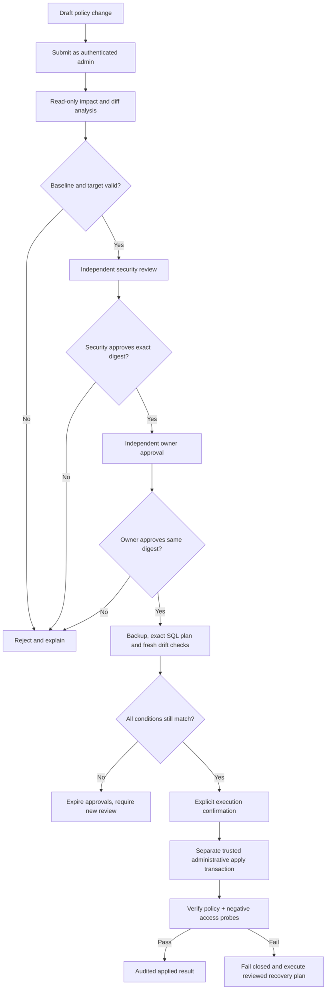

# STARK T2SQL — Permission change review and approval design

**Scope:** owner-approved UI management of application user/persona assignments and the **existing fixed PostgreSQL `public` schema**'s table SELECT, column SELECT, and RLS row-scope rules. This design does NOT authorize immediate database writes, new personas, arbitrary databases/schemas, arbitrary SQL input, or changes to the planted fixture.

**Status on Draft PR #28:** the `Permission Management` page supports **nonpersistent, non-executable source-matrix previews only**. No account authentication, real database comparison, approval, audit store, SQL apply or rollback UI exists yet. No security claims should be made from a preview.

## 1. Two distinct authorization planes

1. **Application account → persona entitlement:** authenticated user identities and administrator approvals managed by a dedicated application-identity store, *not* PostgreSQL's `stark_*_login` service credentials. Signup creates **zero** entitlements. An approved identity may be granted access only to the four original fixture personas. Every server-side request must bind both the authenticated user and their currently granted persona; never trust a UI-selected identity or a Streamlit session flag alone.
2. **PostgreSQL effective role / column / row permissions:** source policy `policy/access_matrix.yaml` compiled by the existing `stark_t2sql.policy.compiler`; installed roles/RLS/grants verified against `pg_catalog` via the existing `ops.install_policy` inventory, catalog checks and probes. Managing these grants through the UI means *requesting and approving reviewed changes*, not issuing ad-hoc `GRANT`, `REVOKE` or `CREATE POLICY` from a browser input.

Never mix the three PostgreSQL business roles with four user-facing simulated personas: HR BP #1 and #2 intentionally share `app_hr_bp` but have different fixture principal IDs. The model and SQL validator are not authorization authorities.

## 2. Fixed change types supported by the management design

| Change type | Target and source | Potential change | Critical review |
|---|---|---|---|
| Application persona assignment | One authenticated app user + one of four fixture personas | Allow/revoke selection | Identity binding, privilege escalation, revoked-session revalidation |
| Table SELECT | One of three existing business roles + one of 12 `public` tables | Grant/revoke read privilege | Sensitive table disclosure, implied column access, effective privileges |
| Column SELECT | Business role + existing table + existing column from reviewed schema | Grant/revoke SELECT | Table-level grant interactions; PostgreSQL column REVOKE alone may not remove a table-level grant |
| Row scope | Role + existing entitled `employees` or `leave_balances` | Propose one of `all`, `direct_reports`, `assigned_divisions`, `via_employees` | RLS expressions, `FORCE ROW LEVEL SECURITY`, indirect relationships, scope-function behavior and child access |

Current source loader enforces three roles, exactly 12 tables and exactly two RLS tables; preserve those invariants. Do **not** enable arbitrary user-written RLS expressions, arbitrary PostgreSQL role names, new schemas, ad-hoc policy names, DDL editor, or unrestricted column types. Proposed scope values are *candidate requests*, not a promise that the current compiler supports the role/table combination; compilation and security regression tests must reject unsupported configurations.

The current preview implementation is `src/stark_t2sql/ui/permission_proposals.py` and `src/stark_t2sql/ui/permission_management.py`. It computes a deterministic source-bound proposal digest. It **does not** calculate installed database permissions, guarantee a compilable policy, or produce SQL. No proposal persistence or apply button exists.

## 3. Workflow — separate UI capability from database mutation

UI sections for authenticated administrators: **Effective Permissions**, **Proposals**, **Diff & Impact**, **Review Queue**, **Execution & Verification**, **Audit Trail**. Ordinary authenticated users see only their own permitted persona entitlements; no ability to approve or apply. No anonymous administrative mutation.

The review stage must include impacted roles, every changed table/column, before/after effective grants, changed RLS scope, affected fixtures and business questions, exposure/denial risks, and exact reproducible SQL generated *only* by the existing compiler for the proposed **reviewed** matrix.

## 4. Exact-plan binding and roles

- **Proposer:** authenticated application administrator, scoped to this local workspace. Cannot approve own change.
- **Security reviewer:** different authenticated administrator with dedicated review entitlement. Must inspect negative-access tests and verify effective PostgreSQL grants/RLS, including HR identity isolation.
- **Owner approver:** separate authenticated owner entitlement; distinct from proposer and security reviewer for high-risk policy changes.
- **Executor:** trusted server-side administrative operation *after* approvals and fresh drift check, never raw SQL from browser, never under a persona login. Reuse the `ops.install_policy` guarded compiler/apply path, and extend it with a **separately reviewed** exact-plan approval integration; do not bypass or weaken its safety checks.
- **Application session authority:** server validates identity, current approval authority and account status on each transition; session-state booleans, UI labels or self-reported emails are not proof of identity.

A durable audit record must bind: proposal ID; actor verified server-side; action/time; precise policy source SHA; fixture/schema version; target `stark_test` server/port/database/OID identity; actual installed catalog policy-state SHA; proposed changed matrix SHA; exact compiled SQL SHA; resource settings hash; reviewer decisions; security/negative-probe evidence digests; backup/restore manifest ID; result and post-apply policy-state digest.

The **same immutable reviewed payload** must be approved by all approvers. Editing a proposal, changing compiler version, replacing backup evidence, changing the database or observing baseline drift invalidates previous approvals. Never approve a moving branch reference alone; use immutable content digests.

## 5. Apply-time safeguards

- No write operations from the frontend's Streamlit render/rerun cycle.
- Require a review-approved migration record in protected storage outside Git, independent owner confirmation and a short-lived server-side authorization for one exact change.
- Require a verified backup and tested restore procedure before mutating `stark_test`; a UI click is not a backup.
- Recheck database identity, current table/column catalog, role memberships, RLS `FORCE`, function bodies, policy-state SHA, auth status and resource limits *immediately before* execution.
- Use the existing trusted one-transaction apply controls. Preserve role hardening, statement timeout, fixed schema and intended RLS relationships. Do not replace policies by blanket grants or temporarily turn off RLS for the application.
- On approval or catalog drift, do not apply. Require a new reviewed plan.
- After apply, independently rerun exact catalog checks, least-privilege probes, negative access probes and per-persona row-scope tests; a successful SQL commit alone is not acceptance.
- Document the known `app.principal_id` single-layer dependency; never claim arbitrary principal spoofing is protected by RLS alone.
- Plan failed-verification recovery separately: do not promise transactional rollback after commit; use owner-approved restored snapshot/migration and isolate connected UI until fixed. Retain audit evidence.
- Account-to-persona changes must invalidate active sessions/permissions quickly; no stale cached permission decisions.

## 6. Tests and acceptance

Tests must demonstrate read-only preview (including rejected targets and no-op detection), no SQL execution on preview, zero privilege from signup, no self-approval, two independent identity-verified approvals bound to digest, rejection on stale policy/database fingerprint, unsupported scope rejection, table/column grant interactions, RLS negative probes, revoked user denial, no secret leakage, safe failure on missing backup and failed post-apply verification.

Live tests run only under explicit owner supervision against a disposable clone or using read-only probes on the authoritative database. Existing installed policy must remain unchanged during this draft PR unless the owner explicitly authorizes the individual exact migration after reviewing the proposal and recovery plan.

## 7. Codex work order

1. Keep and test the existing preview-only UI; improve typing, defensive checks, usability and labels without enabling apply.
2. Complete the normal live UI while model is offline, with actual PostgreSQL metadata and login capability.
3. Design and implement secure admin authentication and dedicated persistent proposal/audit storage. Get threat-model review before enabling administrative mutations.
4. Implement trusted live diff, scope and table/column-impact analyzers against `pg_catalog`, safe compilation, exact-hash approval state machine, two independent approvers, and a reviewed backup/recovery process.
5. Expose actual **Submit / Approve / Execute** buttons only after the corresponding backend security checks exist and each is independently tested; default disabled otherwise.
6. Run full offline suite plus opt-in live validation, produce evidence, and leave Draft PR #28 unmerged for the owner's review.

**Non-goal:** creating a generic administrator console for arbitrary databases or a general-purpose database query interface.
